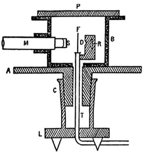
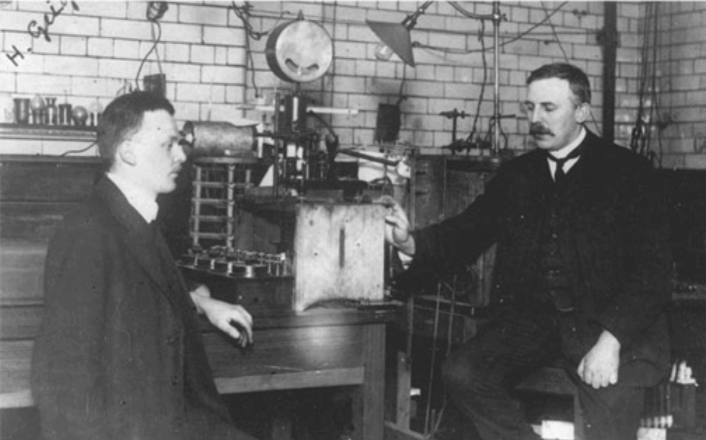

# 4b: Measurements at the High Energy Frontier

## Overview

### The Large Hadron Collider Infrastructure

Located 100 meters underground near Geneva, CERN’s Large Hadron Collider (LHC) spans a 27-kilometer ring that accelerates proton beams to 6.8 GeV, yielding a centre-of-mass energy of 13.6 TeV. Collisions occur at designated interaction points around the ring, providing new insight using scattering experiments at the highest energies. The CERN laboratories provides the collider facilities whilst the experiments recording the collisions are built buy institutes and universities all around the world. 

### ATLAS Detector Architecture and Subsystems

The ATLAS experiment is a general-purpose particle detector surrounding one of the collision points. The detector uses a multi-layered structure to track, identify, and measure particles produced in collisions:

* **Inner Detector**: Located directly around the beam pipe within a central solenoid magnetic field, this system tracks charged particle paths to determine their trajectory and momentum.

* **Calorimeters**: Positioned around the inner tracking region to measure particle energy via total absorption. Electromagnetic calorimeters measure electrons and photons, while hadronic calorimeters measure strongly interacting particles (that is hadrons).

* **Muon Spectrometer**: Forms the exterior layer of the detector, utilizing large toroidal magnets to bend and record the trajectories of penetrating muons.

* **Trigger and Data Acquisition**: A real-time processing system that filters high-rate collision events occurring every few nanoseconds, discarding background interactions and selecting candidate events for permanent storage.

### Scientific Objectives and Research

The experiment tests the limits of particle physics theory and searches for unknown physical phenomena:

* **Higgs Boson Discovery**: Recorded evidence leading to the 2012 discovery of the Higgs boson, verifying the mechanism responsible for generating mass in fundamental particles.
* **Standard Model Precision Measurements**: Reconstructs known particle interactions—such as $W$ and $Z$ boson production—to calibrate detector performance and test quantum chromodynamics (QCD) and electroweak theory at high energies.
* **Beyond the Standard Model Searches**: Probes open cosmological mysteries, including candidate particles for dark matter, explanations for the cosmic matter-antimatter asymmetry, and potential particle substructure or extra dimensions.

### The Large Hadron Collider Infrastructure

Located 100 meters underground near Geneva, CERN’s Large Hadron Collider (LHC) spans a 27-kilometer ring that accelerates proton beams to near the speed of light. High-energy collisions occur at designated interaction points around the ring, recreating extreme energy densities to probe fundamental interactions.

### ATLAS Detector Architecture and Subsystems

The ATLAS experiment is a general-purpose particle detector surrounding one of the collision points. Weighing approximately 7,000 tonnes and measuring 46 meters in length by 25 meters in height, the detector uses a multi-layered structure to track, identify, and measure particles produced in collisions:

* **Inner Detector**: Located directly around the beam pipe within a central solenoid magnetic field, this system tracks charged particle paths to determine their trajectory and momentum.
* **Calorimeters**: Positioned around the inner tracking region to measure particle energy via total absorption. Electromagnetic calorimeters measure electrons and photons, while hadronic calorimeters measure strongly interacting particles.
* **Muon Spectrometer**: Forms the exterior layer of the detector, utilizing large toroidal magnets to bend and record the trajectories of penetrating muons.
* **Trigger and Data Acquisition**: A real-time processing system that filters high-rate collision events occurring every few nanoseconds, discarding background interactions and selecting candidate events for permanent storage.

### Scientific Objectives and Research

The experiment tests the limits of particle physics theory and searches for unknown physical phenomena:

* **Higgs Boson Discovery**: Recorded evidence leading to the 2012 discovery of the Higgs boson, verifying the mechanism responsible for generating mass in fundamental particles.
* **Standard Model Precision Measurements**: Reconstructs known particle interactions—such as $W$ and $Z$ boson production—to calibrate detector performance and test quantum chromodynamics (QCD) and electroweak theory at high energies.
* **Beyond the Standard Model Searches**: Probes open cosmological mysteries, including candidate particles for dark matter, explanations for the cosmic matter-antimatter asymmetry, and potential particle substructure or extra dimensions.

## Detection of particles

Compared to the phosphorescent screen used in Rutherford experiment where the scattered $\alpha$-particles where detected by eye: 

*The positions of the scattered particles were seen as scintillations, or small flashes of light, which were detected using a microscope that could be rotated around the foil. The experiment was quite difficult. Observations could only be taken in a dark laboratory, and it took about half an hour for the observer's eyes to adjust to seeing the traces. Each observer could only count accurately for about a minute before they needed to swap over.* (from: https://web.archive.org/web/20141006232820/http://www-outreach.phy.cam.ac.uk/camphy/nucleus/nucleus4_1.htm)

<div style="display:flex">
     <div style="flex:1;padding-right:10px;">
           
     </div>
     <div style="flex:1;padding-left:10px;">
          
     </div>
     </div>
</div>
Alpha particles (from R) scatter off the foil (F). The microscope (M) is rotated around the cylindrical box (B) to count scattering at any angle. A photograph of the original experiment on the right together with Geiger and Rutherford (left to right).

With time detectors became more sophisticated: They had electronic readout systems (and detected particles and their trajectories could be electronically displayed). Important properties of the detector systems employed to mesure high energy collisions are:

* Almost full solid angle coverage, i.e. full coverage in $\phi$ [0,360$^{\circ}$] and $\theta$ [0,180$^\circ$] 
* Modern detectors have the ability to "ID" particles, i.e. they do not just detect that a particle scattered, they also can identify which type of particle it was.

### General basics of particle detection at ATLAS and CMS

The general purpose experiments at the energy frontier, ATLAS and CMS, do not rely on detailed particle identification for their primary physics goals, but they do require efficient identification of electrons and muons as well as quarks and gluons (as jets and $b$-jets respectively - see below for a definition). These detectors are generally build up from subdetectors as an onion-like structure with three main physical components as described above.

This is achieved mainly through the patterns that different particles will leave in the various subdetectors:

* photons leave no track in the inner tracker (because they are not charged), but will produce a shower in the electromagnetic calorimeter;
* electrons (and positrons) will leave a track and an electromagnetic shower;
* muons will leave a track in the inner tracker, very small energy deposits (consistent with a minimum ionising particle) in both calorimeters, and a track in the muon spectrometer;
* charged hadrons (mainly pions, kaons and protons) will leave a track in the tracker, very little in the electromagnetic calorimeter, and a shower in the hadron calorimeter;
* neutral hadrons (mainly neutrons and ) will leave nothing in the tracker or electromagnetic calorimeter, but will shower in the hadron calorimeter;
* weakly interacting neutral particles (neutrinos) will not be detected, but their presence may be inferred from missing transverse momentum. This is calculated from the vectorial sum of all particles in an event. It should be zero (due to momentum and energy conservation) if there are no invisible particles present and larger than zero in the case, there is one or more particles in the event that did not interact with the detectors.

This will give us basic information.

#### Jets

In week 3 we have learned about the peculiar structure of the strong interaction and the containement of quarks in hadrons. Any quarks produced in collisions will "hadronize", i.e. form hadrons, before they could reach the detectors. Theoretical prediction derived from the Standard Model Lagrangian feature quarks and gluons in the final state, however these will reach detectors in the forms of hadrons. 

After hadronization and detector effects (i.e. the finite size of our detector elements), it’s impossible to reconstruct all particles which originated from a single quark or gluon. However we can measure the total energy of a quark by clustering closeby particles in a so-called Jet, which is a cone around the stream of collimated particles and these generally come from a single quark or gluon. 

```{admonition} Calculation

<b>Three hadrons in a jet</b>

In particle physics detectors, the $z$-axis is defined along the colliding proton beams. The transverse plane ($xy$-plane) is perpendicular to the beam line.

Using **Conservation of Linear Momentum** ($\sum \vec{p}_{\text{initial}} = \sum \vec{p}_{\text{final}}$) and 3D vector geometry, we can analyze three detected hadrons and reconstruct the parent quark that produced them.

Suppose a particle detector measures three hadrons with the following 3-momentum vectors $\vec{p} = (p_x, p_y, p_z)$ in units of **GeV/c**:

* **Hadron 1 ($h_1$):** $\vec{p}_1 = (6.0,\, 8.0,\, 0.2)\text{ GeV/c}$
* **Hadron 2 ($h_2$):** $\vec{p}_2 = (3.6,\, 4.8,\, -0.5)\text{ GeV/c}$
* **Hadron 3 ($h_3$):** $\vec{p}_3 = (2.4,\, 3.2,\, 0.3)\text{ GeV/c}$

First, let's calculate the total moment ($\vert{}\vec{p}\vert{} = \sqrt{p_x^2 + p_y^2 + p_z^2}$) and the transverse momentum ($p_T = \sqrt{p_x^2 + p_y^2}$) of each hadron:

* **$h_1$:** $$\vert{}\vec{p}_1\vert{} = \sqrt{6.0^2 + 8.0^2 + 0.2^2} = \sqrt{100.04} \approx 10.00\text{ GeV/c}$$


$$p_{T,1} = \sqrt{6.0^2 + 8.0^2} = 10.00\text{ GeV/c}$$


* **$h_2$:**

$$\vert{}\vec{p}_2\vert{} = \sqrt{3.6^2 + 4.8^2 + (-0.5)^2} = \sqrt{36.25} \approx 6.02\text{ GeV/c}$$


$$p_{T,2} = \sqrt{3.6^2 + 4.8^2} = 6.00\text{ GeV/c}$$


* **$h_3$:**

$$\vert{}\vec{p}_3\vert{} = \sqrt{2.4^2 + 3.2^2 + 0.3^2} = \sqrt{16.09} \approx 4.01\text{ GeV/c}$$


$$p_{T,3} = \sqrt{2.4^2 + 3.2^2} = 4.00\text{ GeV/c}$$


%---
%
%### Step 2: Demonstrating Spatial Closeness (Opening Angles)

To show how close these hadrons travel relative to one another, we calculate the 3D opening angle $\theta_{ij}$ between each pair using the vector dot product:


$$\vec{p}_i \cdot \vec{p}_j = \vert{}\vec{p}_i\vert{} \vert{}\vec{p}_j\vert{} \cos\theta_{ij} \implies \cos\theta_{ij} = \frac{\vec{p}_i \cdot \vec{p}_j}{\vert{}\vec{p}_i\vert{} \vert{}\vec{p}_j\vert{}}$$

#### 1. Angle between $h_1$ and $h_2$:

$$\vec{p}_1 \cdot \vec{p}_2 = (6.0)(3.6) + (8.0)(4.8) + (0.2)(-0.5) = 21.6 + 38.4 - 0.10 = 59.90\text{ (GeV/c)}^2$$

$$\cos\theta_{12} = \frac{59.90}{10.00 \times 6.02} = \frac{59.90}{60.20} \approx 0.9950 \implies \theta_{12} = \arccos(0.9950) \approx 5.7^\circ$$

#### 2. Angle between $h_1$ and $h_3$:

$$\vec{p}_1 \cdot \vec{p}_3 = (6.0)(2.4) + (8.0)(3.2) + (0.2)(0.3) = 14.4 + 25.6 + 0.06 = 40.06\text{ (GeV/c)}^2$$

$$\cos\theta_{13} = \frac{40.06}{10.00 \times 4.01} = \frac{40.06}{40.10} \approx 0.9990 \implies \theta_{13} = \arccos(0.9990) \approx 2.6^\circ$$

#### 3. Angle between $h_2$ and $h_3$:

$$\vec{p}_2 \cdot \vec{p}_3 = (3.6)(2.4) + (4.8)(3.2) + (-0.5)(0.3) = 8.64 + 15.36 - 0.15 = 23.85\text{ (GeV/c)}^2$$

$$\cos\theta_{23} = \frac{23.85}{6.02 \times 4.01} = \frac{23.85}{24.14} \approx 0.9880 \implies \theta_{23} = \arccos(0.9880) \approx 8.9^\circ$$

All three hadrons are separated by less than $10^\circ$, forming a tight, highly collimated spray of particles (a "jet").

%---%
%
%### Step 3: Deriving the Properties of the Parent Quark

Assuming no other particles were produced in this hadronization process, the parent quark's 3-momentum $\vec{p}_q$ equals the vector sum of its daughter hadrons:

$$\vec{p}_q = \vec{p}_1 + \vec{p}_2 + \vec{p}_3$$

Adding components:

$$p_{x,q} = 6.0 + 3.6 + 2.4 = 12.0\text{ GeV/c}$$

$$p_{y,q} = 8.0 + 4.8 + 3.2 = 16.0\text{ GeV/c}$$

$$p_{z,q} = 0.2 - 0.5 + 0.3 = 0.0\text{ GeV/c}$$

$$\vec{p}_q = (12.0,\, 16.0,\, 0.0)\text{ GeV/c}$$

#### Derived Quark Quantities:

1. **Total 3-Momentum Magnitude:**

$$\vert{}\vec{p}_q\vert{} = \sqrt{12.0^2 + 16.0^2 + 0.0^2} = \sqrt{144 + 256} = 20.0\text{ GeV/c}$$


2. **Transverse Momentum ($p_{T,q}$):**

$$p_{T,q} = \sqrt{12.0^2 + 16.0^2} = 20.0\text{ GeV/c}$$


%#3. **Azimuthal Angle of Flight ($\phi_q$):**

%#$$\tan\phi_q = \frac{p_{y,q}}{p_{x,q}} = \frac{16.0}{12.0} = \frac{4}{3} \implies \phi_q = \arctan\left(\frac{4}{3}\right) \approx 53.1^\circ$$


4. **Longitudinal Momentum Fractions ($z_i$):**
The fraction of the quark's momentum carried away by each hadron along the quark axis is given by $z_i = \frac{\vec{p}_i \cdot \vec{p}_q}{\vert{}\vec{p}_q\vert{}^2}$:
* **Hadron 1:** $z_1 = \frac{(6.0)(12.0) + (8.0)(16.0) + (0.2)(0)}{400} = \frac{72 + 128}{400} = \mathbf{0.50}$ (50%)
* **Hadron 2:** $z_2 = \frac{(3.6)(12.0) + (4.8)(16.0) + (-0.5)(0)}{400} = \frac{43.2 + 76.8}{400} = \mathbf{0.30}$ (30%)
* **Hadron 3:** $z_3 = \frac{(2.4)(12.0) + (3.2)(16.0) + (0.3)(0)}{400} = \frac{28.8 + 51.2}{400} = \mathbf{0.20}$ (20%)

To check that this sums up to the total:
$$\sum_{i=1}^3 z_i = 0.50 + 0.30 + 0.20 = 1.00$$

The parent quark had a total momentum of **20.0 GeV/c** fragmenting into three close hadrons carrying 50%, 30%, and 20% of its momentum respectively.

``` 

#### Electrons

Electrons are reconstructed from track starting from primary interaction vertex (where the collisions happen). They can be further identified by the fact that most of their energy is absorbed in electromagnetic calorimeter (and not in the hadronic calorimeter that is enclosing the electromagnetic one). Electron are usually far away from hadronic particles in a collision as they are not produced together (except if they are produced in the decay of hadrons), i.e. they are *isolated*.  

A balance must be found when selecting electrons and rejecting false signals (e.g. by requiring electrons to be isolated from other particles in the detector). 

#### Muon

To reject false signals tracks from the the track detector and the muon spectrometer are combined. Additionally, two independent measurements can be combined to obtain a more reliable estimate of the muon’s momentum. 

## A cross-section measurement at the LHC 

As we have seen in Rutherford scattering, we have a theory (the Rutherford scattering formula) than we can compare to the data (the measured cross-section) or vice versa. But how do we get there?

### The theory (Scattering prediction)

The Standard Model Lagrangian provides a description of the potential or the forces involved in the scattering or the interaction of fundamental particles. The  Lagrangian contains the mathematical description of the three fundamental forces and therefore can be used to derive the cross-section.

From the distribution of the cross-section, events can be drawn from that distribution, yielding single events - i.e. the energy and the momentum vectors of the incoming and outgoing particles from the collision as well as well-defined types and charges of these *fundamental* particles. 

In a second step, these events will be hadronized, i.e. using a phenomenological model quarks and gluons are turned into hadrons and very short-lived hadrons are additionally decayed such that in the end the prediction contains only those particles that live long enough to impact the detector. This is called a Monte Carlo simulation and events at this stage are the so-called "truth level"

Finally, these events are fed through a simulation of the detector and the output from this simulation is recorded in the same format as the actual data taken from the experiment.

### The data (from the detector)

The detector is build around where the particle collisions are taking place. The particles produced in these collisions traverse through the detector and induce signals in the detector. The signals are converted from electrical to digital signals and then reconstructed into physics objects, which are stored for analysis (this is the same format as for the theory prediction).

So what we end up with is data that is structured in the following way:
* A number of *independent* collision events (e.g. 10,000) 
   * each collision events contains the particles produced in that collision events, e.g.
     * two electrons,
     * one muon,
     * two jets

These can be looped through and prepared by filling them into [counting histograms](https://www.bbc.co.uk/bitesize/articles/zqtpwsg#z86hqyc).

### The analysis / the measurement

1. First you want to decide which scattering process interests you {--} at the LHC we cannot control which scattering events happen at a given time. Their occurance is driven by the cross-sections (probabilities) and ultimately by the fundamental force connected with this process. To measure the cross-sections of different processes gives inside into the structure of the Standard Model (and beyond). Therefore, it's important to make selections targeting specific processes. 

2. Count the number of events (as function of variable of interest) and remove backgrounds (false positive, e.g. mismeasurements in the detector). Whilst this sounds simple (and the examples we will see are simple), this can get really complicated (e.g. constructing quantum entanglement variables or removing backgrounds through complicated normalisation and fitting procedures in multiple dimensions).

3. Correct for the detector efficiencies (i.e. how many of the total number of particle produced was also reconstructed and identified in the detector). You will need to divide by luminosity to get the cross-section (though this might not always be what you are interested in - other variables of interest might be the mass of a particle, accessed through the mean of the resonance). 

