# 4a: First measurements with the ATLAS detector: Confirming what we know

## Reading a research paper

The first measurements with a new detector always cover known "territory" in order to demonstrate that the detector is working, able to reproduce older results and for the analysis teams to understand how things work.

For the ATLAS detector these first measurements are more than 15 years back, but the early measurement papers are still good to read {--} they are much more detailed than more recent ATLAS publications and they describe much more simple measurements than some of the more recent measurements at ATLAS.  

Let go through the first measurements of $W$ and $Z$ Bosons thart were published on 22 July 2010 for a conference. You can find the original publication as [ATLAS-CONF-2010-051 here](https://cds.cern.ch/record/1281306/files/ATLAS-CONF-2010-051.pdf). In the following, the publication is summarized in simpler terms, section-by-section. 

## 0. Always at the beginning: The Abstract

What is the paper about? The ATLAS experiment at the LHC studied the production of **W and Z bosons** in proton–proton collisions at $ \sqrt{s}=7~\text{TeV} $. 
The bosons were studied through their decays into electrons and muons, $ W\rightarrow e\nu $ and $ W\rightarrow\mu\nu $ and $ Z\rightarrow e^+e^- $ and $ Z\rightarrow\mu^+\mu^- $.

The analysis used about $ 17~\text{nb}^{-1} $ of data. ATLAS found **118 W candidates** and **14 Z candidates**. The measured W production rates were consistent with theoretical predictions based on NNLO QCD. The experiment also observed the expected difference between \(W^+\) and \(W^-\) production in proton–proton collisions. 

In simple terms, the paper asks:

> **Can ATLAS see W and Z bosons in the first LHC proton–proton collisions, and do they appear as often as the Standard Model predicts?**

## 1. Introduction

### What is the purpose of the measurement?

$W$ and $Z$ bosons have already been studied extensively before the LHC. Previous experiments measured their masses, lifetimes and interactions very precisely. However, at the LHC, $W$ and $Z$ bosons are produced in proton–proton collisions **at much higher energies** than previous machines.

This gives an opportunity to:

* study the internal structure of the proton;
* test quantum chromodynamics (QCD);
* test predictions of the Standard Model;
* understand how W and Z bosons are produced;
* eventually make more precise measurements, such as the W-boson mass.

The Z boson is also particularly useful because its properties are already well known. If ATLAS reconstructs Z bosons correctly, this provides a way of checking the detector's performance. 

### What data were used?

The data were collected between March and June 2010.

ATLAS found:
* 46 $ W\rightarrow e\nu $ candidates;
* 72 $ W\rightarrow\mu\nu $ candidates;
* 5 $ Z\rightarrow ee $ candidates;
* 9 $ Z\rightarrow\mu\mu $ candidates.

The luminosity was about $ 17~\text{nb}^{-1} $, with an estimated luminosity uncertainty of 11%. 

### Key idea

This was one of the **first physics measurements made with the newly operating ATLAS detector at the LHC**.

## 2. The ATLAS Detector

ATLAS is a very large particle detector surrounding the point where the two proton beams collide. Its job is to measure the particles produced in the collision. ATLAS uses a right-handed coordinate system with its origin at the nominal interaction point (IP)
in the centre of the detector and the \(z\)-axis along the beam pipe.
The \(x\)-axis points from the IP to the centre of the LHC ring,
and the \(y\)-axis points upwards.
Polar coordinates \(r,$\phi$\) are used in the transverse plane, 
\($\phi$\) being the azimuthal angle around the \(z\)-axis. The detector has several important parts. 

### 2.1 Inner detector

The **inner detector** tracks charged particles. A charged particle passing through a magnetic field follows a curved path. From this curvature, ATLAS can determine its momentum. This is particularly important for measuring:

* electrons;
* muons;
* the charge of particles.

The inner detector uses several types of tracking detectors, including silicon detectors and the Transition Radiation Tracker. 

### 2.2 Calorimeters

The calorimeters measure the **energy deposited by particles**. There are electromagnetic and hadronic calorimeters. The electromagnetic calorimeter is particularly important for electrons and photons. The hadronic calorimeter measures energy deposited by particles such as hadrons and jets. The calorimeters cover a large angular region around the collision point. 

### 2.3 Muon spectrometer

Muons are able to pass through the calorimeters much more easily than most other particles which are stopped or absorbed in the calorimeters. Muons are therefore measured in the outer part of ATLAS, called the **muon spectrometer**. Magnetic fields bend the muon trajectory, allowing its momentum to be measured.

### 2.4 Trigger

The LHC produces an enormous number of collisions. ATLAS therefore cannot save every event in full detail. A **trigger system** rapidly examines each collision and decides whether it is interesting enough to keep. For this analysis, the trigger looked for high-energy electrons, photons or muons. 

### Key idea

ATLAS is essentially a collection of specialised measuring devices:

$$
\boxed{\text{track particles}+\text{measure energy}+\text{identify muons}}
$$

Together, these measurements allow physicists to reconstruct what happened in a collision.

## 3. W, Z Processes and Sources of Background

This section explains what ATLAS expects to see.

The researchers use **Monte Carlo simulations** to model both the signal and possible background events.

The simulations include:

* W and Z production;
* QCD jet production;
* top-quark production;
* other electroweak processes.

The predicted W and Z cross sections were calculated using next-to-next-to-leading (NNLO) QCD. Calculations for predictions are carried out as expansions in orders of the coupling constants which acts on the vertex. The expansions are similar to Taylor expansions, so higher orders corresponds to higher exponents on the couplings. 

The predicted total $W$ cross section was

$$
\sigma(W\rightarrow\ell\nu)=10.46~\text{nb}.
$$

The prediction was divided approximately into

$$
W^+:\;6.16~\text{nb}
$$

and

$$
W^-:\;4.30~\text{nb}.
$$

The difference occurs because the LHC collides **protons with protons**. The proton contains more valence \(u\) quarks than \(d\) quarks, and there are no valence antiquarks in a proton. 

## What is background?

A background is an ordinary process that can look like the signal.

For example:

* a hadron can be mistaken for an electron;
* heavy quarks can produce leptons;
* photon conversions can produce electrons;
* $ Z\rightarrow\mu\mu $ can look like a W event if one muon is not detected;
* $ W\rightarrow\tau\nu $ can eventually produce an electron or muon.

QCD jet production is especially important because jets are produced very frequently. 

### Key idea

The experiment is not simply:

> "Find electrons and muons."

It is:

> **Find electrons or muons that have the properties expected from $W$ (or $Z$) decays while rejecting ordinary collisions that imitate them.**

---

## 4. Object Reconstruction

This section explains how ATLAS turns detector signals into identified particles.

### 4.1 Electrons

An electron leaves a track in the inner detector and deposits energy in the electromagnetic calorimeter. ATLAS combines these pieces of information to decide whether the object is really an electron.

Three levels of electron identification are used:

- <b>Loose</b>: A relatively simple selection designed to keep many real electrons.
- <b>Medium</b>: Adds more information from the calorimeter and tracking system to reject background.
- <b>Tight</b>: More stringent information to strongly suppress particles that are not electrons. The stronger the selection, the more background is rejected—but some genuine electrons are also lost. 

### Simple idea

There is a trade-off:

$$
\boxed{\text{keep signal} \quad\leftrightarrow\quad \text{reject background}}
$$

### 4.1.2 Forward electrons (NOT RELEVANT)

In some parts of the detector, there is no inner tracking system. ATLAS can still identify electrons there using the shape and energy of their calorimeter showers. These are called **forward electrons**.

### 4.2 Muons

Muons are identified using both:

* the inner detector;
* the muon spectrometer.

The two measurements can be combined to obtain a more reliable estimate of the muon's momentum. The paper also checks that the measured muon performance in real collision data is reasonably consistent with the Monte Carlo simulation. 

### Key idea

For both electrons and muons, ATLAS needs to answer two questions:

1. **Is this really a lepton?**
2. **How accurately can we measure its momentum or energy?**

## 4.3 Transverse Missing Energy

This is one of the most important parts of the whole experiment.

A W boson can decay as

$$
W\rightarrow\ell\nu.
$$

The lepton is detected, but the neutrino normally passes through ATLAS without interacting.

So how do we know it was there?

#### Conservation of momentum

The proton beams collide along the \(z\)-direction. Whilst the momentum of the protons along the \(z\)-direction is know, this is not known for the quarks and gluons that actually collide.

Therefore, ATLAS concentrates on momentum in the plane perpendicular to the beam—the **transverse plane** as this is zero for the incoming beams, meaning it should also be zero for the total momentum of the outgoing particles. If all visible particles are measured, their transverse momenta should approximately balance (momentum conservation!!). If they do not, the imbalance is called **missing transverse momentum**, expressed here through

$$
E_T^{\rm miss}
=
\sqrt{(E_x^{\rm miss})^2+(E_y^{\rm miss})^2}.
$$

A large missing transverse energy is therefore evidence that an invisible particle may have carried away momentum. 

#### Very important idea

$$
\boxed{
W\rightarrow\ell\nu
\quad\Rightarrow\quad
\text{lepton}+\text{missing transverse energy}
}
$$

This is the key experimental signature of the W boson in this analysis.

## 5. Event Selection and Preparation

Before searching for W and Z bosons, ATLAS has to make sure that the collision data are reliable.

### 5.1 Event selection

Only periods when the detector was operating correctly are used. The experiment also requires evidence that a genuine proton–proton collision occurred. This includes finding a **primary vertex**—the point where the collision occurred. The trigger system then selects potentially interesting events. 

The usable luminosities were approximately:
* $ 16.9~\text{nb}^{-1} $ for $ W\rightarrow e\nu $;
* $ 16.6~\text{nb}^{-1} $ for $ W\rightarrow\mu\nu $.

### 5.2 Event preparation

Not every detector signal comes from the proton collision. For example, the calorimeter can occasionally produce noise or unusual energy deposits. Cosmic rays can also produce signals that look somewhat like collision events. ATLAS therefore applies **event-cleaning requirements** to remove such events.

### Key idea

Before doing physics, the experiment must first make sure that the data are trustworthy.

## 6. Preselection of High-Transverse-Energy Leptons

Now ATLAS begins looking for the particles expected from W decay. The analysis initially requires for both leptons to have $ E_T>20~\text{GeV} $.
This requirements produce a sample containing many possible W events - but also many background events. At this stage, QCD background is still very important.
However, the distribution of missing transverse energy begins to show an excess of events around $ E_T^{\rm miss}\sim40~\text{GeV} $ and above, which is where W events are expected. We can compare the preselected data to Monte Carlo predictions (events predicted from theory additionally fed through a simulation of the detector). 

<div style="display:flex">
     <div style="flex:1;padding-right:10px;">
          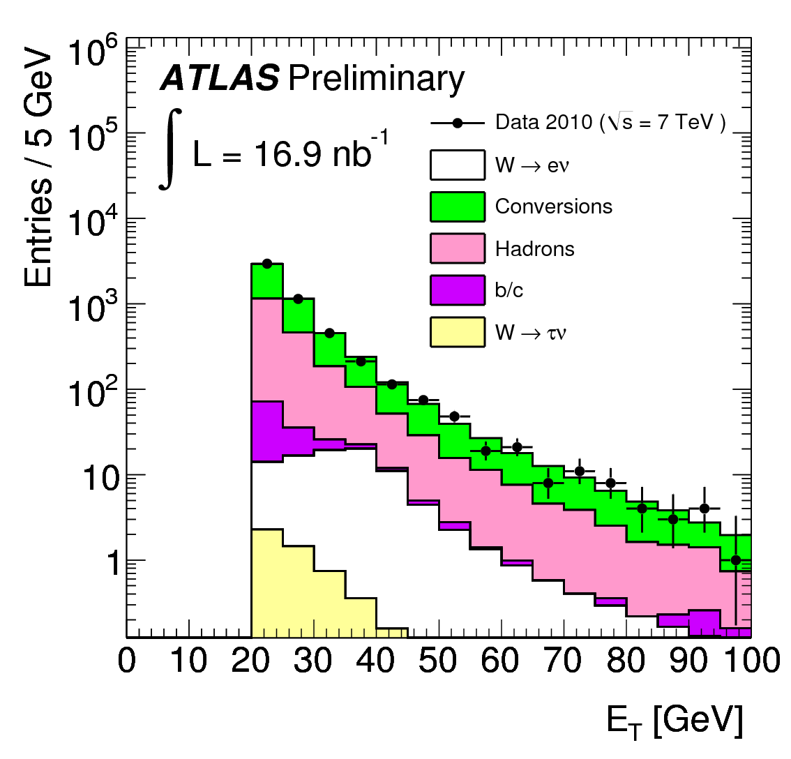a) Electron E<sub>T</sub>
     </div>
     <div style="flex:1;padding-left:10px;">
          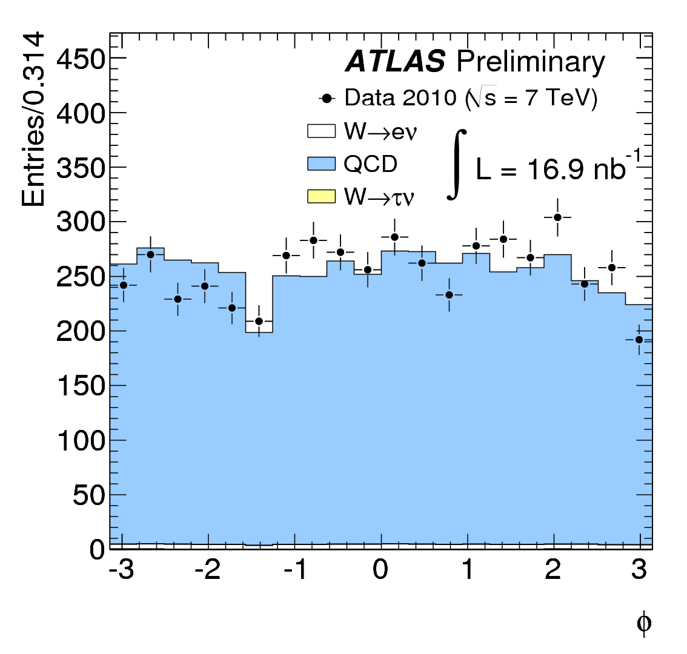b) Electron &#632
     </div>
     </div>
</div>

Calorimeter $E_T$ of the cluster (a), as well as $\phi$ (b) of electron candidates after preselection for data and Monte Carlo candidates broken down into the various signal and background components. The total number of Monte Carlo candidates is normalised to the number of observed data candidates. In Figure (a), the total QCD background is broken down into its constituents: hadrons misidentified as electrons, electrons from conversions, and electrons from semi-leptonic decays of heavy quarks. 


<div style="display:flex">
     <div style="flex:1;padding-right:10px;">
          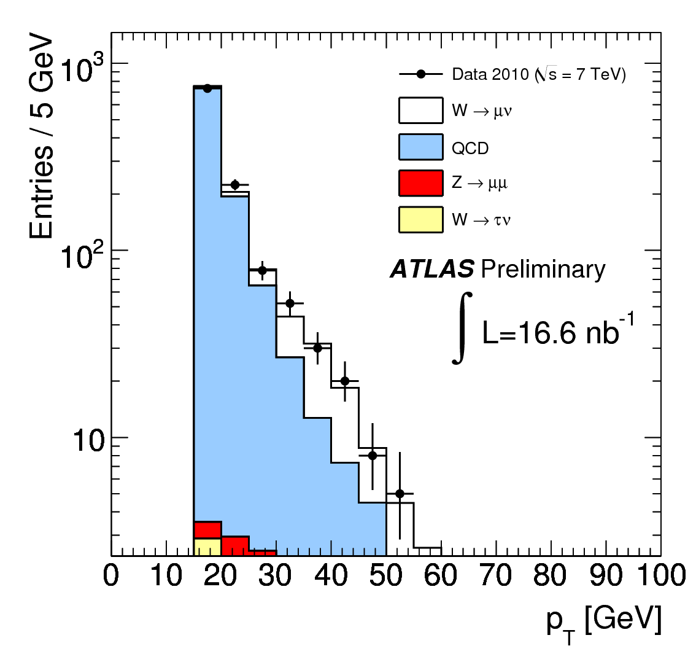a) Muon p<sub>T</sub>
     </div>
     <div style="flex:1;padding-left:10px;">
          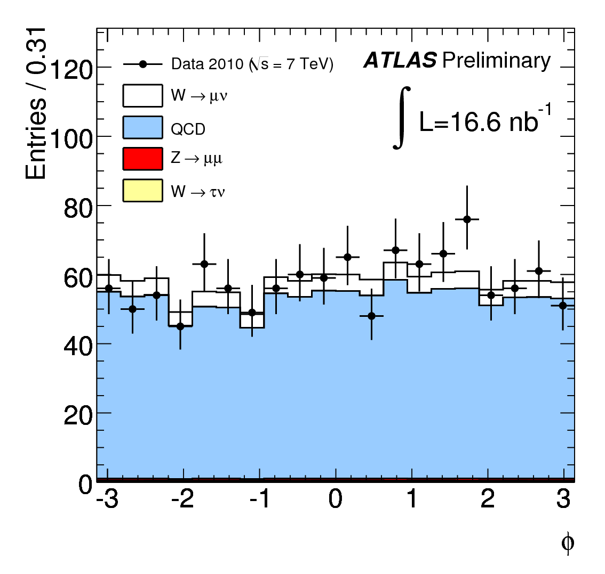b) Muon &#632
     </div>
     </div>
</div>


Combined $p_T$ (a) and $\phi$ (b) of muon candidates after preselection for data and Monte Carlo candidates broken down into the various signal and background components. The total number of Monte Carlo candidates is normalised to the number of observed data candidates. 


### Key idea

The selection is gradually becoming more restrictive:

$$
\text{all collisions}
\rightarrow
\text{lepton candidates}
\rightarrow
\text{possible W events}.
$$


## 7. Selection and Observation of $W$ Candidates

This is where ATLAS makes the $W$ selection more stringent. For electrons, the identification is changed from **loose** to **tight**.
For muons, the minimum transverse momentum is increased to

$$
p_T>20~\text{GeV}.
$$

ATLAS also uses **lepton isolation**.

A W-decay lepton is expected to be relatively isolated from other particles, whereas leptons produced inside jets are often surrounded by additional activity.


<div style="display:flex">
     <div style="flex:1;padding-right:10px;">
          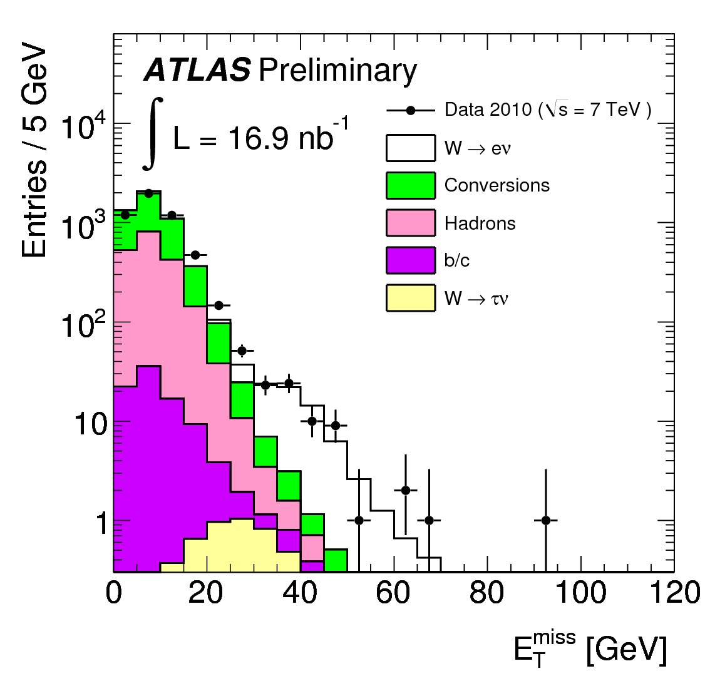a) Electron E<sub>T</sub> 
     </div>
     <div style="flex:1;padding-left:10px;">
          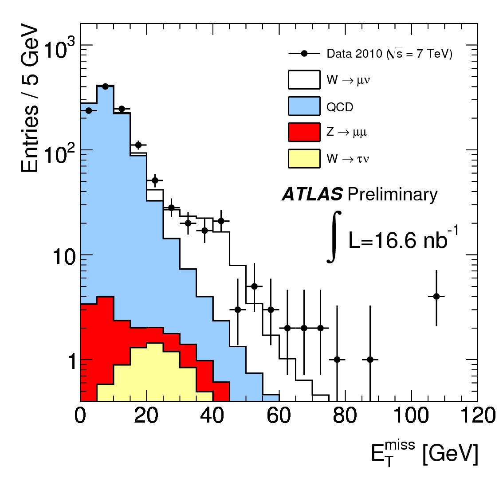b) Muon p<sub>T</sub>
     </div>
     </div>
</div>


Electron candidate $E_T$ (a) and muon candidate $p_T$ (b) after tigher selections (isolation and increased $p_T$ requirements).  


### Missing transverse energy

The final W selection requires

$$
E_T^{\rm miss}>25~\text{GeV}.
$$

This helps identify events containing a neutrino.

<div style="display:flex">
     <div style="flex:1;padding-right:10px;">
          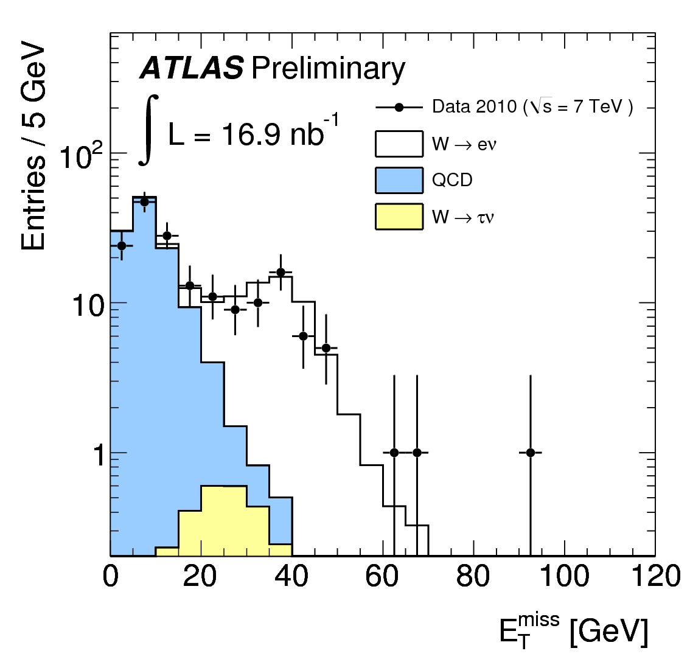a) Electron E<sub>T,miss</sub> 
     </div>
     <div style="flex:1;padding-left:10px;">
          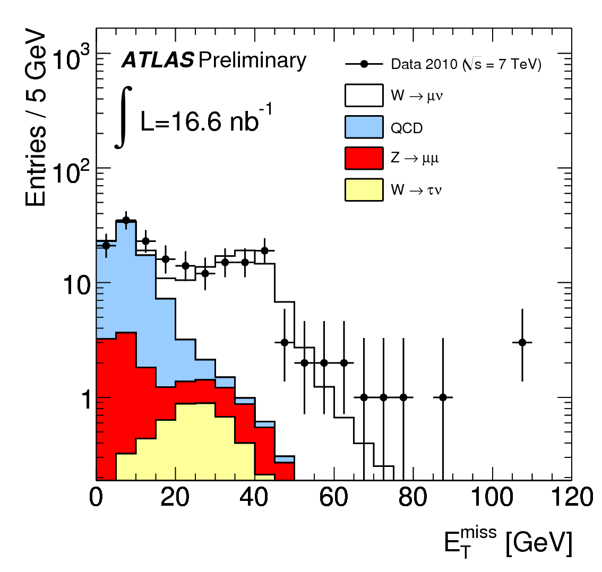b) Muon E<sub>T,miss</sub>
     </div>
     </div>
</div>

Electron (a) and muon (b) candidate $E_{T,\textrm{miss}}$ distribution before selecting only events with $E_T^{\rm miss}>25~\text{GeV}$. This demonstrates how the number of background events can be removed from the final sample whilst keeping most of the events that are expected to be signal (i.e. be stemming from W decays).  


### Transverse mass

ATLAS also calculates 

$$
m_T=
\sqrt{
2p_T^\ell E_T^{\rm miss}
(1-\cos\Delta\phi)
}.
$$

The final requirement is $m_T>40~\text{GeV}$. This further suppresses background.

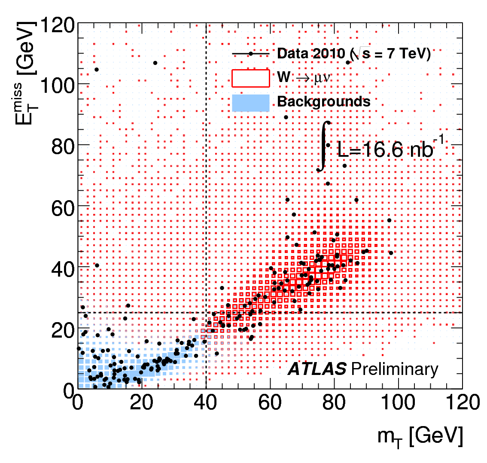

ETMiss versus mT of the lepton-ETMiss system for the muon channel. (The electron channel looks very similar). The cuts on $E_T^{\rm miss}$ and $m_T$ are indicated. Cutting on both helps in addition, but most of the rejection comes from cutting on one of the two variables alone. 

### How many events survive?

For the electron channel:

$$
2.4\times10^6
\rightarrow 5.1\times10^3
\rightarrow177
\rightarrow49
\rightarrow46.
$$

For the muon channel:

$$
2.0\times10^6
\rightarrow1155
\rightarrow420
\rightarrow186
\rightarrow77
\rightarrow72.
$$

So millions of triggered events are reduced to only a few dozen W candidates. Note that these numbers contain *both* signal and background events. 

### Key idea

This is essentially a **filtering process**:

$$
\boxed{
\text{millions of collisions}
\rightarrow
\text{tens of W candidates}
}
$$

The challenge is making sure those remaining events are genuinely W events.


## 8. Properties of $ W\rightarrow\ell\nu $  Candidates

After the final selection, ATLAS studies the properties of the candidate events.

The final selection is:

* good lepton identification;
* appropriate lepton momentum;
* lepton isolation;
* $ E_T^{\rm miss}>25~\text{GeV} $;
* $ m_T>40~\text{GeV} $.

The distributions of lepton energy, momentum and pseudorapidity are compared with Monte Carlo predictions.

The data and simulations show reasonable agreement.

<div style="display:flex">
     <div style="flex:1;padding-right:10px;">
          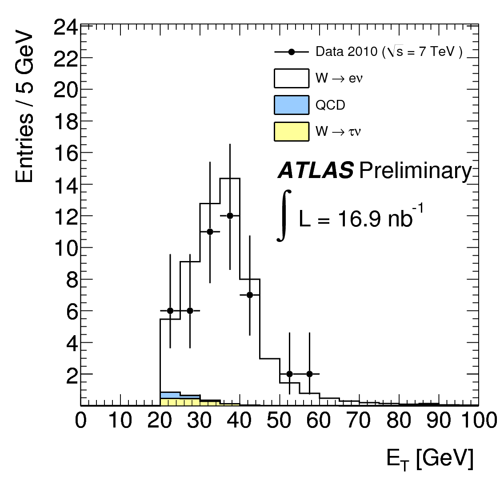a) Electron E<sub>T</sub> 
     </div>
     <div style="flex:1;padding-left:10px;">
          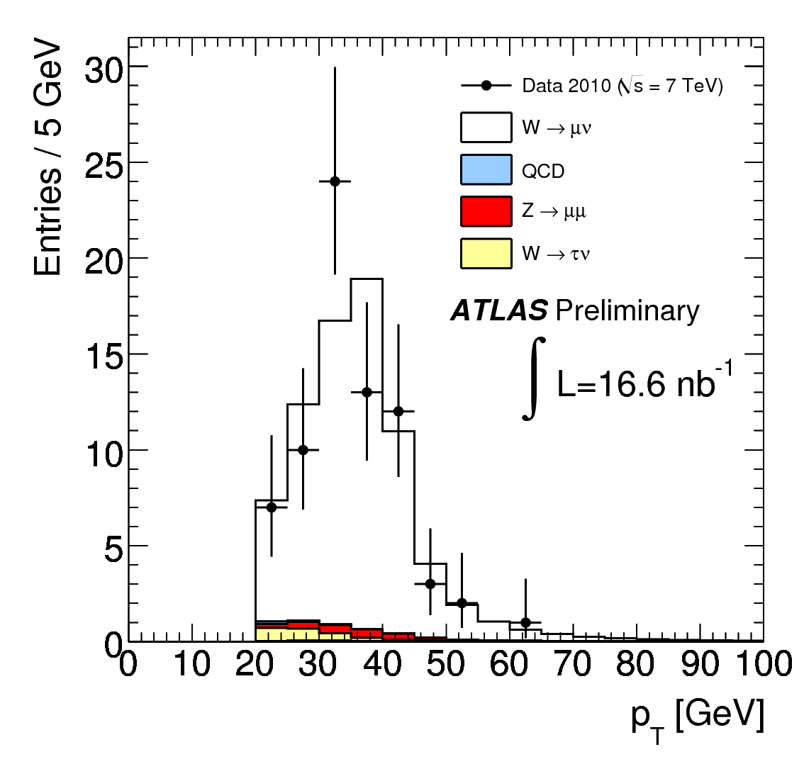b) Muon E<sub>T</sub>
     </div>
     </div>
</div>

Electron cluster $E_T$ (a) and muon $p_T$ (b) of the W candidates after final selection. $E_T^{\rm miss}>25~\text{GeV}$ and $m_T>40~\text{GeV}$ are required in both channels. Clearly: Most of the selected events are from real $W$ bosons. 

An interesting feature is that there are more positive leptons than negative leptons in some regions of pseudorapidity.

This is related to the fact that $W^+$ and $W^-$ are produced at different rates in proton–proton collisions. 

### Key idea

The experiment is checking not only **how many** W events it sees, but also **whether the detailed properties of those events look like W events**.


## 9. Background Expectations for the $ W\rightarrow\ell\nu $ Candidates

Now ATLAS asks an important question:

> Of the events that passed the W selection, how many are actually background?

The paper treats the two lepton channels somewhat differently.

### 9.1 Electron channel

The main backgrounds include:

* QCD processes;
* hadrons mistaken for electrons;
* electrons from photon conversions;
* electrons from heavy-quark decays;
* $ W\rightarrow\tau\nu $;
* $ Z\rightarrow ee $.

The QCD background is estimated using the **electron isolation** distribution. ATLAS performs a fit to determine how much of the sample looks like QCD background. The estimated QCD background after the final selection is

$$
1.1\pm0.2\text{ (stat)}
\pm0.4\text{ (syst)}
$$

events. Together with other backgrounds, this is very small compared with the number of W candidates. 

### 9.2 Muon channel

The main backgrounds are:

* $ Z\rightarrow\mu\mu $;
* $ W\rightarrow\tau\nu $;
* QCD multijet events;
* top production;
* $ Z\rightarrow\tau\tau $.

The total estimated background is about **5.3 events**. For the QCD component, ATLAS uses the relationship between $ E_T^{\rm miss} $ and $\text{muon isolation}$. The idea is to define regions dominated by background and use them to estimate how much background enters the signal region. 


### 9.3 Observed candidate events

The final numbers are:

| Channel                        | Observed | Background | Signal after background subtraction |
| ------------------------------ | -------: | ---------: | ----------------------------------: |
| $ W^+\rightarrow e^+\nu $      |       27 |       ~1.5 |                                25.6 |
| $W^-\rightarrow e^-\bar\nu$  |       19 |       ~1.2 |                                17.8 |
| $W\rightarrow e\nu$          |   **46** |       ~2.6 |                            **43.4** |
| $W^+\rightarrow\mu^+\nu$     |       47 |       ~3.1 |                                43.8 |
| $W^-\rightarrow\mu^-\bar\nu$ |       25 |       ~2.2 |                                22.8 |
| $W\rightarrow\mu\nu$         |   **72** |       ~5.3 |                            **66.7** |


### Key idea

The experiment does not simply use the raw number of events. It first calculates

$$
\boxed{
N_{\rm signal}
=
N_{\rm observed}
-
N_{\rm background}.
}
$$

That corrected number is then used to calculate the cross section.

## 10. Cross-Section Measurements for $W$-Boson Decays

This is the main physics measurement of the paper.

### 10.1 Introduction

The cross section is calculated using

$$
\boxed{
\sigma\times BR
=
\frac{N_{\rm signal}}
{A_W C_W L_{\rm int}}
}
$$

where:

* $N_{\rm signal}$ = number of $W$ events after background subtraction;
* $A_W$ = fraction of $W$ events falling within the detector's allowed kinematic region;
* $C_W$ = detector efficiency and correction factor;
* $L_{\rm int}$ = integrated luminosity.


This equation is worth understanding. Imagine 1000 W bosons are produced. Perhaps only some:

1. decay into the particular lepton channel;
2. travel into the part of the detector being studied;
3. pass the selection criteria;
4. are successfully reconstructed.

The experiment therefore has to correct the observed number back to the number that was actually produced and this is covered by $A_W$ (1. and 2.) and $C_W$ (3. + 4.).

### 10.2 Detector-related efficiencies and scale factors

Not every particle is detected perfectly.

For example:

* a real electron might not be reconstructed;
* a muon might fail the trigger;
* a detector measurement might have limited resolution.

These effects are described using **efficiencies** and **correction factors**. For the electron channel, the overall correction factor was approximately $
C_W=0.656.$ For the muon channel, $C_W=0.814.$

The corresponding systematic uncertainties were about 8% and 7%. 

#### Key idea

A detector is not perfect, so:

$$
\boxed{\text{measured events}\neq\text{all events produced}}
$$

The experiment has to correct for this.

### 10.3 Geometrical acceptance

Even if a W boson is produced, its decay products may go into a region where ATLAS cannot measure them well.

The **acceptance** $A_W$ is the fraction of generated events satisfying the required kinematic and geometrical conditions. For example, the analysis requires sufficiently large lepton momentum and appropriate pseudorapidity.

The acceptance is determined using Monte Carlo simulations. For the combined W sample, the acceptance is approximately $A_W\approx0.46$ for electrons and $
A_W\approx0.48$ for muons. 

The main theoretical uncertainty here comes from our imperfect knowledge of the **parton distribution functions (PDFs)** inside the proton.

### 10.4 Measured Cross Sections

After correcting for background, detector efficiency, acceptance and luminosity, ATLAS obtains the W cross sections. For the combined electron and muon measurements:

$$
\sigma(W^+)=
5.7\pm0.7_{\rm stat}
\pm0.4_{\rm syst}
\pm0.6_{\rm lumi}
~\text{nb},
$$

$$
\sigma(W^-)=
3.5\pm0.5_{\rm stat}
\pm0.2_{\rm syst}
\pm0.4_{\rm lumi}
~\text{nb},
$$

and

$$
\sigma(W^\pm)=
9.3\pm0.9_{\rm stat}
\pm0.6_{\rm syst}
\pm1.0_{\rm lumi}
~\text{nb}.
$$

### 10.5 Comparison with Theoretical Calculations

Now the experiment compares the measured numbers with theory. Theoretical predictions are calculated using **NNLO QCD** and the FEWZ program. The measured W cross sections agree with the theoretical predictions within the experimental uncertainties.

The paper also compares the measurements with older experiments at the Tevatron and earlier CERN collider experiments. The energy dependence of W production is found to be consistent with theoretical expectations. 

### Key idea

This is the crucial test:

$$
\boxed{\text{Experiment}\quad\text{vs}\quad\text{Theory}}
$$

The agreement means that the Standard Model description of W production works well in this new proton–proton collision environment.

### 10.6 Lepton Asymmetries

The paper then looks at the difference between positive and negative W production. The lepton charge asymmetry is defined as

$$
A=
\frac{\sigma_{\ell^+}-\sigma_{\ell^-}}
{\sigma_{\ell^+}+\sigma_{\ell^-}}.
$$

If positive and negative leptons were produced equally often, then $A=0.$ But proton–proton collisions naturally produce an asymmetry. The measured asymmetry also changes with **pseudorapidity** $\eta$ (this is a transformation of the scattering angle $\theta$ - you do not need to know the definition).

This is useful because different values of $\eta$ probe different regions of the proton's internal parton momentum distribution. Therefore, W charge asymmetry measurements provide information about the distribution of quarks inside the proton. 

#### Why is this interesting?

The measurement is therefore doing more than counting W bosons.

It is also asking:

> **What can W production tell us about the quarks inside the proton?**

## 11. Observation of Z Candidates

The Z boson provides a cleaner signature than the W boson because there is no neutrino in $Z\rightarrow\ell^+\ell^-.$

Both leptons can be detected.

ATLAS therefore searches for pairs of:

* electrons with opposite charge, or
* muons with opposite charge.

The two leptons should have an invariant mass close to the Z-boson mass.

The analysis uses the mass range

$$
66<m_{\ell\ell}<116~\text{GeV}.
$$

### What is invariant mass?

If two particles are produced together, their energies and momenta can be combined to calculate an invariant mass.

For two approximately massless leptons,

$$
m_{\ell\ell}^2
=
2E_1E_2(1-\cos\theta),
$$

in a simplified form.

A concentration of events around the known Z-boson mass is evidence that the two leptons came from a Z decay.

### What did ATLAS observe?

ATLAS found $5\quad Z\rightarrow ee$ and $9\quad Z\rightarrow\mu\mu$ candidates. So in total: 14 $Z$ candidates were observed.

The expected number was approximately 14.2. This is a very good consistency check.

### Why is the Z useful?

Because the Z boson's properties are already well known, Z events can be used to check:

* lepton reconstruction;
* energy and momentum measurements;
* detector efficiencies;
* trigger performance.

## 12. Summary

The paper's final message is quite simple.

ATLAS studied early LHC proton–proton collisions at

$$
\sqrt{s}=7~\text{TeV}.
$$

It observed W bosons through $W\rightarrow e\nu$ and $W\rightarrow\mu\nu$ using the characteristic signature of 

$$
\boxed{\text{one energetic lepton + missing transverse energy}}.
$$

A total of **118 W candidates** were observed. After correcting for backgrounds, detector efficiency, acceptance and luminosity, ATLAS measured the W production cross section.

The results were consistent with NNLO QCD predictions.

ATLAS also observed **14 Z candidates**, compared with an expectation of 14.2. 

The experiment also confirmed the expected difference between $W^+$ and $W^-$ production in proton–proton collisions.

## The whole paper in one picture

The logic of the paper can be summarised as:


$$
\boxed{
pp\text{ collisions}
}
$$

$$\downarrow$$
			

$$
\boxed{
W\text{ or }Z\text{ produced}
}
$$

$$\downarrow$$

$$
\boxed{
\textrm{select decay channel, for  } W: W\rightarrow\ell\nu
}
$$


$$\downarrow$$


$$
\boxed{
\text{lepton detected}
+
\text{missing }E_T
}
$$

$$\downarrow$$


$$
\boxed{
\textrm{Remove background}
}$$

$$\downarrow$$

$$
\boxed{Correct for detector efficiency and acceptance
}$$

$$\downarrow$$

$$
\boxed{\textrm{Calculate }\sigma\times BR}
$$

$$\downarrow$$


$$
\boxed{Compare with QCD prediction}$$

$$\downarrow$$


$$
\boxed{\textbf{Agreement with theory}}$$

---

## The five ideas to remember

**1. A particle is often identified indirectly.**
The neutrino is not detected directly; its presence is inferred from missing transverse momentum.

**2. Experimental particle physics is largely a problem of separation.**
The experiment has to separate a small signal from a much larger background.

**3. Counting events is not enough.**
The observed number must be corrected for detector efficiency, geometrical acceptance and luminosity.

**4. Cross sections allow experiment and theory to be compared.**

$$
\boxed{\text{measure }\sigma\quad\longleftrightarrow\quad\text{predict }\sigma}
$$

**5. The W and Z measurements are also measurements of the proton.**
The different rates of $W^+$ and $W^-$ contain information about the quarks inside the proton.

### One-sentence takeaway

> **ATLAS used the characteristic signatures of W and Z decays to demonstrate that the newly operating LHC detector could reconstruct these particles, measure their production rates, and obtain results consistent with the Standard Model.** 


```{admonition} Learning objectives
:class: Tip


### Detector Subsystems and Coordinates

* Describe the layout and coordinate system ($r, \phi, \eta, z$) of the ATLAS detector and explain the distinct roles of the Inner Detector (tracking), Calorimeters (energy measurement), and Muon Spectrometer (penetrating track reconstruction).


%* Explain the function of the trigger system in filtering high-rate collision events to select high-transverse-momentum leptons.


### Object Reconstruction and Experimental Signatures

* Identify the characteristic experimental signatures of $W \to \ell \nu$ (high-$p_T$ lepton + missing transverse energy) and $Z \to \ell^+ \ell^-$ (opposite-sign lepton pair) decay channels.


* Explain how missing transverse energy ($E_T^{\text{miss}}$) is derived from transverse momentum conservation to infer the presence of non-interacting neutrinos.


* Evaluate the trade-off between signal efficiency and background rejection across different electron selection levels (Loose, Medium, Tight) and lepton isolation requirements.


* Calculate the transverse mass ($m_T$) of a lepton-$E_T^{\text{miss}}$ system and the invariant mass ($m_{\ell\ell}$) of a dilepton system to isolate $W$ and $Z$ boson signals.


### Background Rejection and Cross-Section Measurement

%* Identify major background sources in electroweak boson searches (such as QCD multijet production, misidentified hadrons, and photon conversions) and explain strategies to suppress them.


* Perform background subtraction to extract the net signal yield ($N_{\text{signal}} = N_{\text{observed}} - N_{\text{background}}$) from candidate event samples.


* Calculate production cross-sections using the relation:

$$\sigma \times BR = \frac{N_{\text{signal}}}{A_W C_W L_{\text{int}}}$$


defining the physical roles of geometrical acceptance ($A_W$), detector efficiency/correction factors ($C_W$), and integrated luminosity ($L_{\text{int}}$).


* Categorize sources of experimental error into statistical, systematic, and luminosity uncertainties.


### Standard Model Validation and Proton Substructure

* Explain why initial collider measurements focus on known Standard Model processes ($W$ and $Z$ bosons) to benchmark detector performance and calibrate lepton energy/momentum scales.


* Account for the observed excess of $W^+$ over $W^-$ production in proton-proton collisions using the valence quark content of the proton ($uud$).


* Define the lepton charge asymmetry:

$$A = \frac{\sigma_{\ell^+} - \sigma_{\ell^-}}{\sigma_{\ell^+} + \sigma_{\ell^-}}$$


and explain how its dependence on pseudorapidity ($\eta$) provides constraints on proton Parton Distribution Functions (PDFs).


```